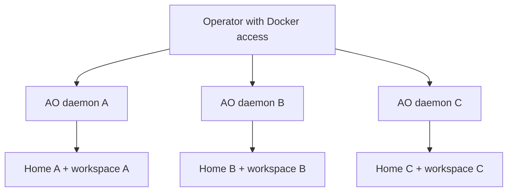

# Marik isolation lab

Baseline: upstream main at `b2ba4532ffabbce563bbe68030007b334aaa54e6` (Apache-2.0). Stable release at discovery: v0.14.9. This lab builds the Go daemon from source and uses three independently managed containers. The service names designate intended roles. Provider clients and credentials are deliberately absent from this offline test fixture.

## Architecture decision



Use separate AO daemon instances for the first isolation milestone. The current Codex account switch is global to a daemon. The app-server and Claude ACP drivers launch local subprocesses and rely on local paths and process streams. A central daemon would need an authenticated worker protocol that translates workspace and runtime operations and supports cancellation, stream backpressure, and idempotent reconciliation. The Compose lab keeps upstream lifecycle behavior and introduces no mobile wire changes.

| Capability | Assessment | Evidence and next step |
| --- | --- | --- |
| Codex accounts | Existing, incomplete | `service/agent/codex_account_switch_coordinator.go` describes a global switch with a journal. Account-specific home exists for account operations in `codexappserver/account.go`. Keep each worker on a separate home and daemon. Track upstream issues #7385 and #7242. |
| Codex and Claude transports | Existing, local | `adapters/chatdriver/codexappserver` and `claudeacp` own subprocess lifecycles. Exercise pinned provider binaries with approved accounts in separate hosts before adding RPC. |
| Worktrees | Existing | `adapters/workspace/gitworktree` has prepare, reclaim and removal tests. Worktrees share Git metadata. Give each worker its own clone and serialize publish operations for the same target. |
| Remote and mobile | Existing, experimental for self-hosting | `docs/self-hosted-remote.md` documents AO account discovery, manual pairing and VM setup. Test on an authorized VPN-connected host before enabling it. |
| Dependency scheduling and remote worker lease | Missing for this layout | Add a controller only after provider sessions work. Persist task DAG, worker eligibility and leases. Treat lost leases as interrupted, reconcile before resubmitting, cap retries and keep a human approval gate for ambiguous outcomes. |
| Pull requests | Existing upstream GitHub workflows and PR integration | Use task branches and human-reviewed PRs. Workers should receive no GitHub write token. Use a separate publisher with repository-scoped credentials and configure protected main after owner approval. |

## Run on a development Docker host

From the repository root:

```sh
docker compose -f deploy/marik/docker-compose.yml build
docker compose -f deploy/marik/docker-compose.yml up -d --wait codex-a
docker compose -f deploy/marik/docker-compose.yml exec codex-a ao --help
docker compose -f deploy/marik/docker-compose.yml down
deploy/marik/smoke.sh
```

Use `--profile fleet` to enable the two additional daemons. Normal shutdown preserves volumes. The smoke script uses its own temporary project namespace and removes its test volumes. Use `--env-file deploy/marik/.env.example` if you want a separate namespace for manual testing.

The image uses digest-pinned base images. OS package versions follow the Debian repository at build time. The lab mounts no host paths, publishes no ports, and disables networking, including provider egress. Each worker runs with UID 10001, an init process, a read-only root filesystem, dropped capabilities and bounded CPU, memory and PIDs.

## Account enrollment and Git

For a connected pilot, first approve a private host and define allowlisted provider and Git endpoints at its network boundary. Install reviewed, pinned Codex and Claude builds for that host. Authenticate A as Marik, B in a separate runtime by its consenting owner, and C via an authorized Claude mechanism. Use interactive device authorization or the provider's supported secret mechanism. Verify each worker's identity in its own runtime. Never copy another worker's credential files. Plan a clean revocation and re-enrollment when replacing a worker.

Keep push and PR credentials in a separate publisher. Review a patch before transferring it to a task branch. If the target advanced, check for conflicts in a disposable clone and return unresolved conflicts to the operator. Require reviews and verified CI on main, and disable automation that merges PRs.

## Mobile pilot

Use the official app and a matching self-hosted AO release on a separate test VM. Review the pinned bootstrap and setup scripts before executing them. For manual pairing, put the VM and iPhone on a private VPN, constrain the AO LAN listener to the private network, and pair using Settings → Machines and the host's private address and pairing secret. Treat the pairing password and QR as credentials. The upstream LAN option uses HTTP inside the private transport. Keep the loopback control API separate from that listener.

On a physical iPhone, record results for pairing, remote connectivity, monitoring, agent selection, task creation, approval, push, PR review, terminal access and reconnection after restart. The offline Compose fixture cannot test those functions.

## Backup, rollback and troubleshooting

Stop the selected Compose project before copying state so SQLite and its sidecars are consistent. Export the named home and workspace volumes through a temporary container with read-only source mounts. Encrypt the archives, restrict access and keep each worker's archive separate. Record the source commit, image digest and volume names. Restore into fresh volumes in a new offline project, preserve file ownership, and run the readiness check before enrolling accounts.

Build an upgrade from a reviewed commit with a new immutable image tag. Test against a copy of the stopped volumes. Roll back by restoring the previous image and its pre-upgrade volume snapshots together, since a newer binary may migrate SQLite. For unhealthy instances inspect local logs and readiness inside the container. Avoid sharing raw logs or state archives. Offline DNS and provider failures are expected if live agent commands are attempted in the fixture.

## התחלה מהירה

1. במחשב בדיקות עם Docker ו־Compose, עברו לתיקיית המאגר.
2. הריצו `docker compose -f deploy/marik/docker-compose.yml build` לבניית התמונה.
3. הריצו `deploy/marik/smoke.sh` לבדיקת שלושת המופעים והפרדת הנתונים ביניהם.
4. סביבת הבדיקה פועלת ללא רשת וללא חשבונות ספק. חיבור חשבונות ואייפון דורש סביבת ניסוי פרטית ואישור מבעלי החשבונות.
